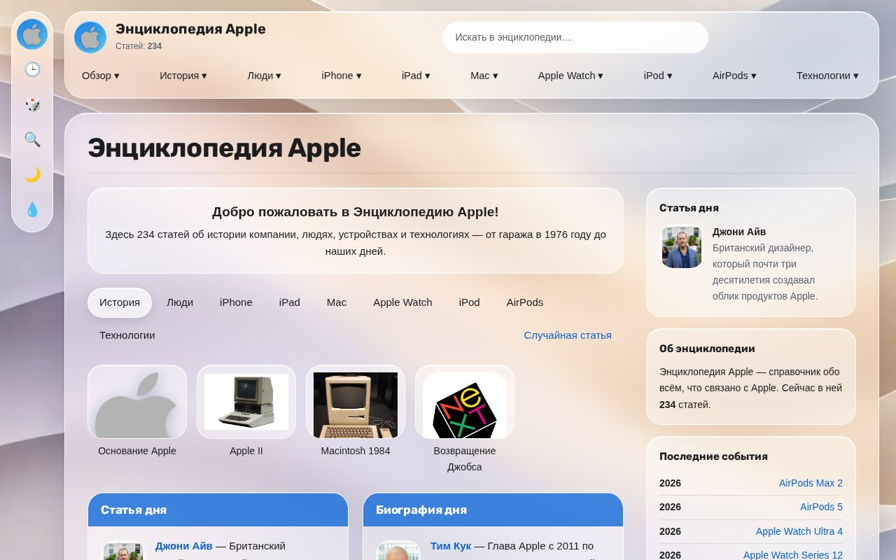
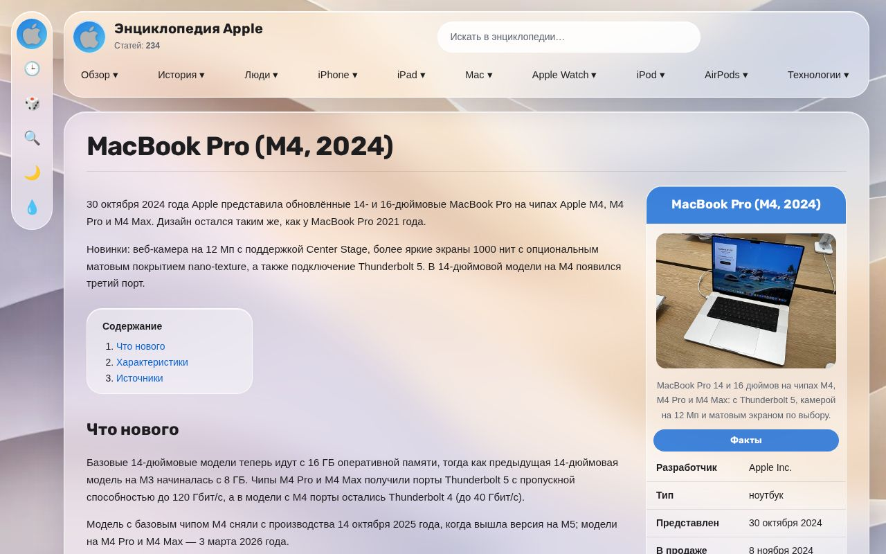

# 🍎 Энциклопедия Apple



Энциклопедия на русском языке об истории Apple: люди, iPhone, iPad, Mac, Apple Watch, iPod, AirPods и технологии.
Всего 234 статьи, от гаража в 1976 году до наших дней.

## Что умеет

- **Статьи об устройствах** с карточкой фактов, цветами, историей и источниками.
- **Разделы и линейки:** в меню модели сгруппированы по семействам (MacBook Air, iPad Pro, Apple Watch Ultra…).
- **Хронология** всех событий по годам.
- **Поиск с подсказками** и **случайная статья**.
- **Светлая и тёмная темы** и стеклянный дизайн в стиле Liquid Glass.



## Как запустить у себя

Нужен Python 3.

```bash
python3 -m venv venv
venv/bin/pip install -r requirements.txt
venv/bin/flask --app app run
```

Откройте http://localhost:5000.

## Структура

```
app.py                 сайт на Flask: страницы, поиск, подсказки
articles.py            статьи об истории, людях и технологиях, плюс общий список всех статей
iphones.py, ipads.py,  статьи об устройствах по разделам
macs.py, watches.py,
ipods.py, airpods_models.py
templates/             шаблоны страниц
static/                стили, скрипты и картинки
```

## Фото, тексты и лицензии

- **Фото устройств и людей** взяты с [Wikimedia Commons](https://commons.wikimedia.org) под свободными лицензиями
  (CC BY, CC BY-SA, CC0, общественное достояние). Автор и лицензия каждого фото указаны внизу его статьи,
  со ссылкой на страницу файла. Если свободного фото модели нет, вместо него показан эмодзи.
- **Тексты** частично переведены с [Apple Wiki](https://apple.fandom.com) и английской [Википедии](https://en.wikipedia.org)
  (CC BY-SA). Ссылка на оригинал есть в каждой статье.
- **Логотип Apple и значок App Store** взяты с Wikimedia Commons. Это товарные знаки Apple Inc.,
  и здесь они используются только для того, чтобы показать, о чём статья.
- **Фоновые обои** нарисованы нейросетью специально для этого сайта.

Это учебный проект, он не связан с Apple Inc.
